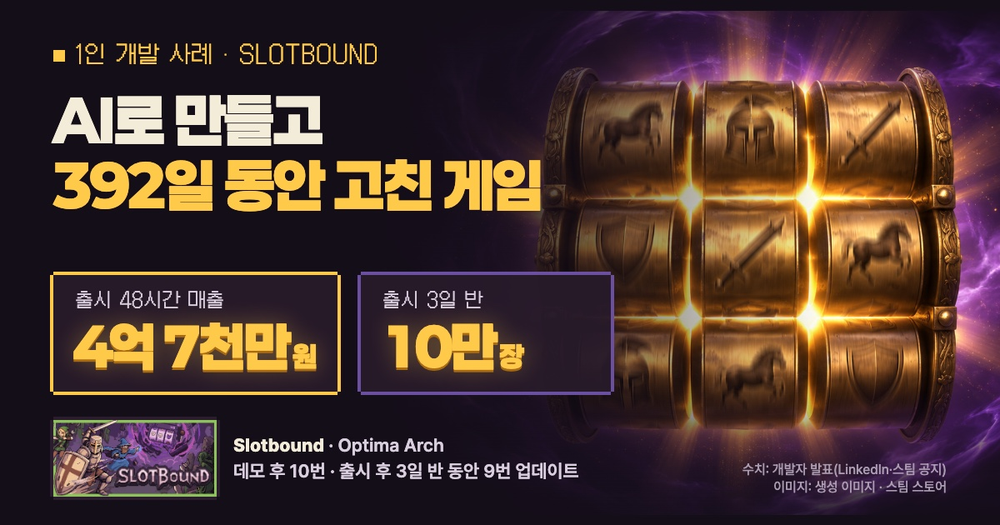

# Slotbound(슬롯바운드) 사례 발표

1인 개발자 Min Kim(Optima Arch)이 AI로 만들고 392일 동안 고친 게임 Slotbound의 개발 과정, 비하인드, 출시 전후 확산 경로를 정리한 발표 자료입니다. 20초 인트로 영상과 모션 그래픽이 들어간 HTML 슬라이드 34장으로 구성했습니다.

## 바로 보기

- 슬라이드: <https://revfactory.github.io/slotbound-case-study/>
- 인트로 영상(20초): [downloads/slotbound_intro_20s.mp4](downloads/slotbound_intro_20s.mp4)
- PDF(34쪽): [downloads/slotbound_deck.pdf](downloads/slotbound_deck.pdf)

## 조작

| 키 | 동작 |
| --- | --- |
| F | 전체 화면 |
| → 또는 Space | 다음 장 |
| ← | 이전 장 |
| N | 발표자 노트 |

- 1장은 재생 버튼을 눌러야 인트로 영상이 소리와 함께 재생됩니다.
- 8·13·27·32장은 클릭할 때마다 단계가 하나씩 열립니다.
- Chrome에서 1920×1080 비율로 보는 것을 기준으로 만들었습니다.

## 내용 기준

- 숫자와 날짜는 [팩트시트.md](팩트시트.md)에서 확인된 항목만 썼습니다. 조회 시각은 2026-11-17 17:33 KST 전후이고, 2차 보완 자료(리뷰 언어 분포, 유튜브 조회수 등)는 같은 날 19:56 KST 전후입니다.
- 4억 7천만 원과 10만 장은 개발자가 직접 발표한 값입니다. 4억 7천만 원은 "매출"로만 표기했습니다.
- 출시일은 한국 시간 기준 2026.11.13입니다. 스팀 스토어의 11월 12일 표기는 미국 태평양 시간입니다.
- 발표자의 의견은 보라색 "발표자 관점" 상자에 따로 넣었고, 사실 문장과 섞지 않았습니다.
- 확산 요인은 "확인 / 시점 겹침 / 추정"으로 근거 수준을 나눠 적었습니다. 유튜브 영상이나 LinkedIn 게시가 판매를 이끌었다고 단정하지 않습니다.
- 리뷰 언어 분포는 리뷰를 쓴 언어 기준입니다. 판매 지역 분포가 아닙니다.
- AI 고지 게임 통계(Sulka Haro 집계)는 스토어의 AI 사용 고지 여부를 센 것이며, 게임의 품질을 잰 것이 아닙니다.
- 제작 과정, 사용 도구, 알려진 한계는 [제작노트.md](제작노트.md)에 있습니다.

## 출처와 이미지

- 게임 로고, 스크린숏, 트레일러 화면은 Slotbound 스팀 스토어 공식 미디어입니다. 저작권은 Optima Arch에 있습니다.
- 인트로의 방, 슬롯 릴, 아파트 장면은 생성 이미지와 생성 영상(codex-image, Higgsfield)입니다. 실존 인물을 묘사하지 않습니다.
- 슬라이드 34장에 출처 목록이 있습니다.

## 폰트

Pretendard, Paperlogy, JetBrains Mono, Galmuri. 모두 SIL Open Font License 1.1 폰트입니다.
